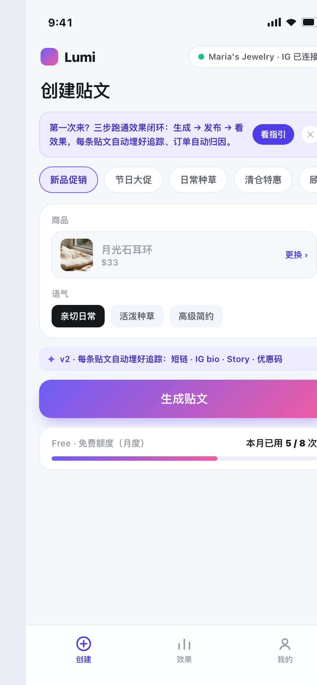
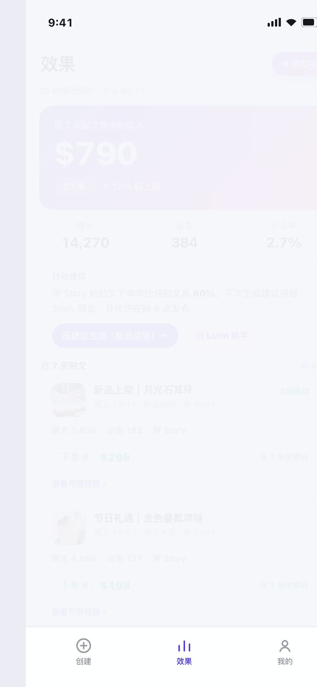
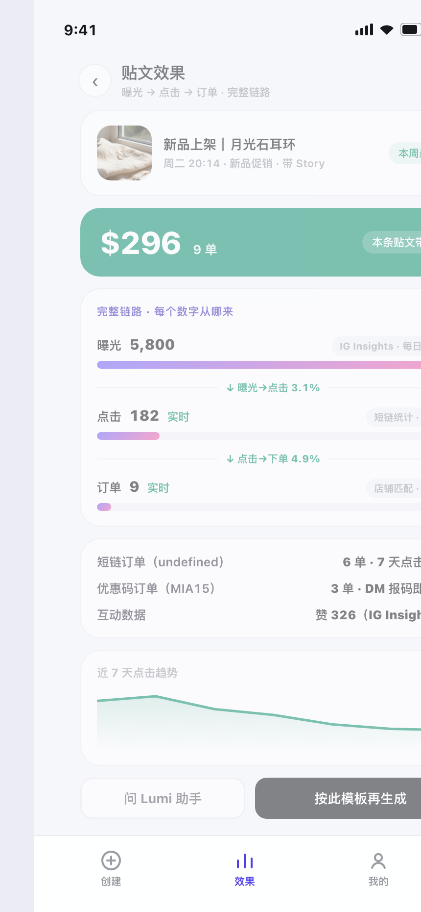
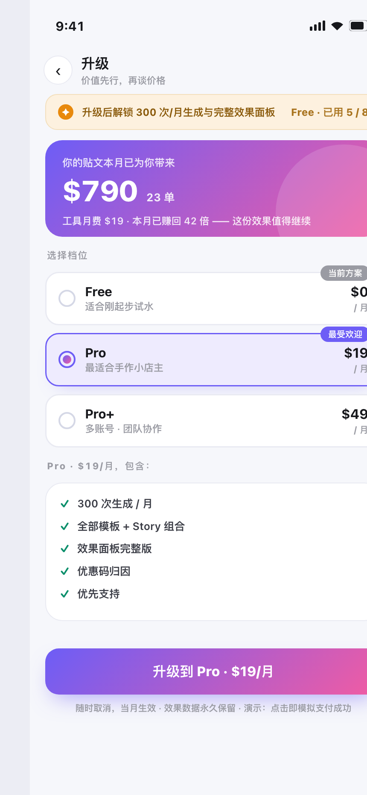

# Lumi · Instagram 内容营销效果闭环工具（可交互原型）

> **贴文发了，就知道这条贴文值多少钱。**

Lumi 是一款面向独立卖家与小微商家的 Instagram 内容营销工具。这份**高保真可交互原型**演示了 v2 的核心命题——**效果闭环**：贴文在发布前自动埋好追踪能力，发布后自动回收数据并归因订单，让卖家第一次看清「内容 → 生意」的完整链路。

**在线演示**：https://timedetective.github.io/lumi-prototype/

---

## 它解决什么问题

小卖家在 IG 上发贴文，点赞涨了、店铺也来单了——但没人说得清**这条贴文到底带来了几单、值多少钱**。内容与生意之间一片漆黑，带来的直接后果：

- **不敢投入**：不知道哪条贴文有效，该多发还是停发全凭感觉；
- **付费焦虑**：工具月费 $19，无法证明「贴文赚回了几倍工具费」，续费意愿快速衰减；
- **无法优化**：换模板、换语气、改发布时间，都缺少数据依据。

Lumi v2 的答案：**每条贴文自动埋点（追踪短链 / bio 轮换 / 配套 Story / 专属优惠码），发布后数据自动回传（点击实时统计 / IG 曝光每日同步 / 订单双通道归因），效果面板把收入放在最大字号，行动建议再把数据结论反哺到下一次生成。**

## 界面一览

| 创建贴文 | 效果面板 |
|:---:|:---:|
|  |  |

| 贴文效果详情 | 升级页（价值先行） |
|:---:|:---:|
|  |  |

## 核心能力

| 模块 | 亮点 |
|---|---|
| **AI 生成贴文** | 模板 × 商品 × 语气；六步可视化生成，自动产出贴文文案 + Story 文案 + 追踪短链 + 专属优惠码 |
| **一键发布 + 自动埋点** | 发布时 bio 链接自动指向最新贴文（link-in-bio 中转页方案），无需手动埋任何点 |
| **效果面板** | 近 7 天贴文带来的收入与订单置顶展示；每条贴文曝光 / 点击 / 下单一目了然 |
| **完整链路漏斗** | 曝光（IG Insights·每日）→ 点击（短链统计·实时）→ 订单（店铺匹配·实时），每个数字都标注来源与时效 |
| **双通道订单归因** | 短链（7 天点击窗口）+ 优惠码（DM 报码即归因），未识别订单诚实展示在脚注，不夸大覆盖 |
| **行动建议** | 数据结论直接变成可执行建议（如「新品促销 × Story 组合持续有效」），一键按建议生成下一条 |
| **AI 助手** | 为什么这条贴文效果好？帮我优化文案？下周发什么？——回答带工具调用标注，可信可执行 |
| **订阅付费** | Free / Pro / Pro+ 三档；付费墙价值先行：先展示贴文已赚回几倍月费，再谈价格 |

## 演示动线（六步，完成自动打勾）

1. **生成一条贴文** —— 追踪能力自动埋好
2. **发布到 Instagram** —— bio 链接自动更新
3. **快进 24 小时** —— 看这条贴文带来了多少订单
4. **按数据建议再生成** —— 闭环合拢
5. **体验额度用尽** —— 付费墙价值先行
6. **升级 Pro** —— 额度解锁，自动续跑被中断的生成

原型完整覆盖边界状态：AI 生成超时（失败不扣额度，可直接重试）、数据回传中、IG 未授权降级（点击与订单统计不受影响）、额度用尽付费墙。

## 本地运行

无需安装任何依赖，克隆后双击打开即可：

```bash
git clone https://github.com/TimeDetective/lumi-prototype.git
open lumi-prototype/index.html   # 或用 Chrome / Safari 直接打开
```

- 窗口 ≥ 960px：桌面演示视图（说明栏 + 手机模拟器）
- 窗口更小：自动切换纯手机视图
- 「我的」页提供演示控制：快进额度用完、模拟生成失败、断开 IG、重置演示

## 关键设计决策

- **价值先行的付费墙**：不先谈价格——先展示「本月贴文已带来 $537，是工具月费的 28 倍」，再呈现三档方案；升级入口用底部固定 CTA，任何滚动位置都可见。
- **诚实的归因口径**：归因不到的订单明确显示「来源未识别，不计入上表」，把预期管理做进产品，而不是做给数据看。
- **最小侵入的首次体验**：不做一打开就弹的全屏指引，改为创建页一条可关闭的轻量提示；完整指引收到「我的」页。
- **IG 授权降级不伤主链路**：断开 IG 后曝光/互动不可见，但短链点击与订单归因照常工作——追踪能力建立在自己的短链体系上，不受平台权限绑架。

## 技术说明

- **纯前端单文件 H5**（`index.html`，无构建、无依赖、无框架），约 2000 行，可直接部署到任何静态托管；
- 原型内置状态机驱动全部页面与弹层（生成 / 发布 / 回传 / 升级），35 个交互动作事件委托统一分发；
- 全部数据为演示 mock（店铺 Maria's Jewelry），无真实用户数据；「⏩ 快进」按钮仅存在于原型中。

## 目录结构

```
├── index.html          # 原型全部代码（单文件）
├── assets/             # 演示商品素材图
└── screenshots/        # README 界面截图
```

## License

[MIT](LICENSE) © 2026 TimeDetective
